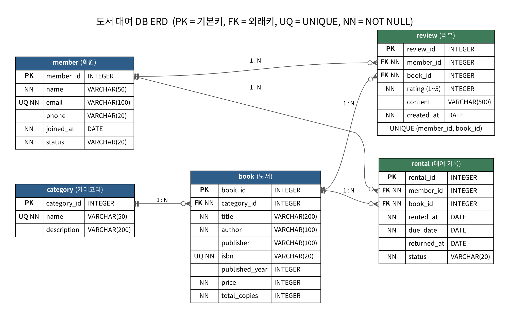

# 정보를 깔끔하게 정리하는 디지털 서랍장 — 도서 대여 DB

SQLite로 만든 **도서 대여 서비스** 데이터베이스입니다. 백엔드 프레임워크 없이 SQL만으로
스키마 설계 → 데이터 입력 → 요구사항 쿼리 작성까지 진행했습니다.

- DB : **SQLite 3** (파일 기반, 별도 서버 불필요)
- 실행 도구 : sqlite3 CLI 또는 DBeaver / DB Browser for SQLite
- 기준일 : 2026-10-29 (샘플 데이터와 '연체' 판단의 기준 날짜)

## 제출물 구성

| 파일 / 폴더 | 내용 |
|---|---|
| `01_schema.sql` | 스키마 생성 스크립트 (CREATE TABLE 5개, PK/FK/NOT NULL/UNIQUE/CHECK) |
| `02_insert_data.sql` | 샘플 데이터 INSERT 스크립트 (테이블당 10~20행) |
| `03_queries.sql` | 핵심 쿼리 19개 (조회·조인·집계·서브쿼리·수정/삭제·인덱스) |
| `04_bonus.sql` | 보너스 과제 3개 (JOIN vs 서브쿼리, FK 에러 재현, 미니 리포트) |
| `results/` | 쿼리별 실행 결과 텍스트 (`Q01_*.txt` ~ `Q19_*.txt`, 전체 모음 `ALL_RESULTS.txt`) |
| `erd.png` | ERD 다이어그램 (원본 `erd.dot`, Graphviz) |
| `run_all.py` | 01→04를 순서대로 실행해 `results/`를 다시 만드는 보조 스크립트 |

## 실행 방법

```bash
# 방법 1) sqlite3 CLI — 반드시 01 → 02 → 03 → 04 순서
sqlite3 library.db < 01_schema.sql
sqlite3 library.db < 02_insert_data.sql
sqlite3 -box library.db < 03_queries.sql
sqlite3 -box library.db < 04_bonus.sql

# 방법 2) 결과 텍스트까지 자동 생성 (Python 내장 sqlite3 사용)
python3 run_all.py
```

DBeaver에서 실행할 때는 SQLite 연결을 만든 뒤 각 파일을 열어 **스크립트 실행(Alt+X)** 하면 됩니다.

> **주의 (SQLite 전용)** — SQLite는 FK 검사가 기본으로 꺼져 있습니다. 모든 스크립트 맨 위에
> `PRAGMA foreign_keys = ON;` 을 넣어 두었고, 이 설정은 접속할 때마다 다시 켜야 합니다.

## 도메인 설계

### 테이블 구성과 역할

| 테이블 | 역할 | 행 수 | 왜 이렇게 나눴나 |
|---|---|---|---|
| `category` | 도서 분류 | 10 | 분류명을 도서마다 문자열로 반복 입력하면 '소설'/'소설 '처럼 표기가 흔들린다. 한 곳에서 관리하고 번호로 참조한다. |
| `member` | 회원(사람) | 12 | 사람의 정보는 대여와 무관하게 존재한다. 이메일이 바뀌어도 여기 한 행만 고치면 된다. |
| `book` | 도서(사물) | 15 | 책의 정보도 대여와 무관하게 존재한다. 같은 책을 100번 빌려도 책 정보는 한 번만 저장한다. |
| `rental` | 대여 기록 — "누가 언제 무엇을 빌렸다"는 **사건** (대여일·반납 예정일·반납일·상태) | 20 | 회원과 도서는 N:M이고, 그 사이에 빌린 날·반납 예정일·반납일·상태라는 사건 고유의 정보가 붙는다. 그래서 별도 테이블이 필요하다. |
| `review` | 도서 리뷰 — "누가 어떤 책을 몇 점으로 평가했다"는 **사건** (평점 1~5) | 15 | 대여와 성격이 다른 사건(평점·본문·작성일)이라 `rental`에 섞지 않고 분리했다. |

핵심 기준은 **"사람 / 사물 / 사건"의 분리**입니다. 사람과 사물은 명사형 마스터 테이블로 두고, 둘 사이에서 벌어지는 일은 FK 두 개를 가진 사건 테이블(`rental`, `review`)로 풉니다.

### 1:N 관계 5개

| 관계 | FK | 도메인에서의 의미 |
|---|---|---|
| `category` 1 : N `book` | `book.category_id → category.category_id` | 'IT/컴퓨터' 카테고리에 9·10·11번 도서가 속합니다. 한 책이 두 카테고리에 동시에 속하지는 않게 설계했습니다. |
| `member` 1 : N `rental` | `rental.member_id → member.member_id` | 회원 1번 김민준은 대여 기록 1·4·10·16번을 가집니다. 한 사람은 여러 번 빌릴 수 있지만, 하나의 대여 건은 반드시 한 사람의 것입니다. |
| `book` 1 : N `rental` | `rental.book_id → book.book_id` | 도서 9번 "클린 코드"는 대여 1·8·17번에 등장합니다. 한 책은 (반납 후) 여러 번 대여되지만, 한 대여 건이 가리키는 책은 하나입니다. |
| `member` 1 : N `review` | `review.member_id → member.member_id` | 회원 한 명이 여러 책에 리뷰를 씁니다. |
| `book` 1 : N `review` | `review.book_id → book.book_id` | 책 한 권에 여러 사람의 리뷰가 달립니다. |

- **FK는 항상 N쪽 테이블에 둡니다.** 회원 한 명이 대여 여러 건을 가지므로, 회원 테이블에 대여 번호를 여러 개 적는 대신 대여 테이블이 회원 번호 하나를 갖습니다.
- `rental`과 `review`는 회원과 도서 사이의 **N:M 관계를 풀어 주는 연결 테이블** 역할도 합니다.
- `review`에는 `UNIQUE (member_id, book_id)`를 걸어 **한 회원이 같은 책에 리뷰를 두 개 쓰지 못하게** 했습니다. 관계는 1:N이지만 도메인 규칙으로 한 번 더 조인 것입니다.

### 컬럼 타입 선택

| 타입 | 쓴 컬럼 | 이유 |
|---|---|---|
| `VARCHAR(n)` | `name`, `title`, `author`, `email`, `isbn`, `phone` | 길이가 정해진 짧은 문자열. 길이 제한 자체가 "이 칸에 긴 글이 들어오면 잘못된 입력"이라는 1차 검증이 된다. |
| `INTEGER` | `price`, `total_copies`, `published_year`, `rating` | 정렬·합계·평균 같은 계산 대상이라 숫자여야 한다. 문자열로 저장하면 `'9000' > '15000'`처럼 사전순 비교가 되어 버린다. 원화는 소수점이 없어 실수형 대신 정수로 둔다. |
| `DATE` | `rented_at`, `due_date`, `returned_at`, `joined_at`, `created_at` | 날짜 대소 비교와 기간 조회(BETWEEN)를 해야 한다. `'YYYY-MM-DD'` 형식으로만 저장하면 문자열 비교와 날짜 비교 결과가 같아 SQLite에서도 안전하다. |
| `NULL` 허용 | `returned_at` | **"아직 반납하지 않았다"를 NULL로 표현**하기 위해서다. 빈 문자열이나 `'0000-00-00'` 대신 NULL을 쓰면 `WHERE returned_at IS NULL` 한 줄로 미반납 건을 뽑을 수 있다(Q03). |

전화번호(`phone`)를 숫자가 아닌 문자열로 둔 것도 같은 맥락입니다. 앞자리 0이 사라지면 안 되고, 더하거나 평균 낼 값이 아니기 때문입니다.

### 제약조건

| 제약 | 적용한 곳 | 막아 주는 것 |
|---|---|---|
| `NOT NULL` | `member.name`, `book.title`, `rental.rented_at`, `rental.due_date` 등 | 비어 있으면 의미가 성립하지 않는 값 |
| `UNIQUE` | `member.email`, `book.isbn`, `category.name`, `review(member_id, book_id)` | 중복 가입, 같은 책 중복 등록, 한 책에 같은 사람의 리뷰 2개 |
| `CHECK` | `status`, `rating BETWEEN 1 AND 5`, `price >= 0`, `due_date >= rented_at` | 타입만으로는 못 막는 값 (평점 7점, 반납 예정일이 대여일보다 빠른 경우 등) |
| `FOREIGN KEY` | `book.category_id`, `rental.member_id`, `rental.book_id`, `review.member_id`, `review.book_id` | 존재하지 않는 회원·도서·카테고리를 가리키는 '고아 데이터' |

FK가 선언만 된 게 아니라 **실제로 막히는지** 확인한 기록은 [04_bonus.sql](04_bonus.sql)의 B2와 `results/B2-*.txt`에 있습니다. 없는 회원(999)으로 대여 입력, 없는 카테고리(50)로 도서 입력, 대여 기록이 있는 회원 삭제 — 세 가지 모두 `FOREIGN KEY constraint failed`로 거부됐습니다.

### 인덱스

- `idx_rental_member_id` → `rental(member_id)`
  회원별 대여 내역 조회(Q10)와 `member`와의 JOIN에서 **가장 자주 조건으로 걸리는 컬럼**입니다. 게다가 SQLite는 FK 컬럼에 인덱스를 자동으로 만들어 주지 않아서, 없으면 매번 `rental` 전체를 훑습니다. 생성 후 `EXPLAIN QUERY PLAN` 결과가 `SCAN rental` → `SEARCH rental USING INDEX idx_rental_member_id (member_id=?)`로 바뀌는 것을 확인했습니다([results/Q19](results/Q19_CREATE_INDEX_대여_테이블_FK_컬.txt)).
- `idx_rental_status_due` → `rental(status, due_date)`
  연체 점검(Q16)처럼 **두 컬럼을 함께 거는 조회**가 반복되기 때문에 복합 인덱스로 묶었습니다. 순서를 `(status, due_date)`로 둔 이유는 `status = 'RENTED'`로 먼저 후보를 좁힌 뒤 `due_date` 범위를 보는 질의 형태이기 때문입니다.

인덱스를 아무 컬럼에나 걸지는 않았습니다. 인덱스는 INSERT/UPDATE마다 함께 갱신해야 해서 쓰기가 느려지고 저장 공간도 더 씁니다. 그래서 **값의 종류가 많고(선택도가 높고), WHERE·JOIN·ORDER BY에 반복해서 쓰이는 컬럼**에만 거는 것이 기준입니다. 예를 들어 `member.status`는 값이 2종류뿐이라 단독 인덱스 효과가 거의 없고, PK와 UNIQUE 컬럼(`email`, `isbn`)은 이미 인덱스가 자동 생성됩니다.



## 쿼리 목록 (03_queries.sql)

| 번호 | 범주 | 확인 내용 |
|---|---|---|
| Q01 | 기본 조회 | 2015년 이후 출간 도서 (최신순) |
| Q02 | 기본 조회 | 가격이 높은 도서 TOP 5 |
| Q03 | 기본 조회 | 미반납 대여 건 (반납 예정일 순) |
| Q04 | 기본 조회 | 제목·저자 키워드 검색 (LIKE) |
| Q05 | 기본 조회 | 최근 30일 대여 기록 |
| Q06 | INNER JOIN | 현재 대여 중인 책 목록 (회원·도서 3테이블) |
| Q07 | INNER JOIN | 도서 목록 + 카테고리명 |
| Q08 | INNER JOIN | 평점 4점 이상 리뷰 상세 (4테이블) |
| Q09 | LEFT JOIN | 대여된 적 없는 도서 포함 전체 대여 이력 |
| Q10 | 집계 | 회원별 대여 횟수 (0회 포함) |
| Q11 | 집계 | 카테고리별 도서 수·총 보유 권수·평균 가격 |
| Q12 | 집계 | 평균 평점 랭킹 (리뷰 2개 이상, HAVING) |
| Q13 | 집계 | 월별 대여 건수 추이 |
| Q14 | 서브쿼리 | 대여 기록이 없는 회원 |
| Q15 | 서브쿼리 | 평균 정가보다 비싼 도서 |
| Q16 | UPDATE | 기한 지난 미반납 건을 OVERDUE로 변경 (3건) |
| Q17 | UPDATE | 17번 대여 반납 처리 |
| Q18 | DELETE | 13번 리뷰 삭제 (15 → 14건) |
| Q19 | 인덱스 | rental.member_id 인덱스 생성 후 사용 여부 확인 |

- 범주별 개수 : 기본 조회 5 · 조인 4(INNER 3, LEFT 1) · 집계 4 · 서브쿼리 2 · 수정/삭제 3 · 인덱스 1 = **19개**
- 쿼리마다 바로 위에 `-- 설명:` 한 줄로 "무엇을 확인하는 쿼리인지" 적어 두었고, 실행 결과는 [results/](results/)에 쿼리별 텍스트로 남겼습니다.
- Q16~Q18은 데이터를 바꾸므로 조회 쿼리 뒤에 두었고, 각 결과 파일에 **변경 전·후 조회**를 함께 남겼습니다.
- 인덱스 선정 이유는 위 [도메인 설계 → 인덱스](#인덱스) 참고.

## 보너스 과제 (04_bonus.sql)

1. **JOIN vs 서브쿼리** — "IT/컴퓨터 도서를 빌린 회원"을 두 방식으로 풀어 같은 결과(3명)를 확인.
   JOIN은 1:N 때문에 행이 늘어나 `DISTINCT`가 필요하고, 서브쿼리는 존재 여부만 판단해 중복이 생기지 않는다는 차이를 정리했습니다.
2. **정합성 깨뜨려 보기** — 없는 회원(999)으로 대여 입력, 없는 카테고리(50)로 도서 입력, 대여 기록이 있는 회원 삭제를 시도해
   모두 `FOREIGN KEY constraint failed`로 막히는 것을 확인하고, 부모 행을 먼저 넣는 방식으로 해결했습니다.
3. **미니 리포트 핵심 지표 3개** — 월별 대여 건수·연체율 추이, 인기 도서 TOP 10, 연체율 높은 회원 목록.

보너스는 03 실행 이후 상태에서 동작하며, B2-4에서 21번 대여가 추가되므로 B3-1의 10월 건수는 9건으로 나옵니다.

## 핵심 개념 정리

### 데이터베이스와 엑셀의 차이

엑셀이라면 대여 기록 한 줄에 회원 이름·이메일·전화번호·책 제목·저자·카테고리를 전부 적게 됩니다. 20건을 빌리면 김민준의 이메일이 4번 중복 저장됩니다. 여기서 세 가지 문제가 생깁니다.

1. **수정 이상** — 이메일이 바뀌면 흩어진 4곳을 모두 고쳐야 하고, 하나라도 놓치면 같은 사람의 이메일이 두 개가 됩니다. DB는 `member` 한 행만 고치면 끝입니다.
2. **입력 이상** — 엑셀은 존재하지 않는 회원 이름이나 오타가 난 카테고리도 그냥 받아들입니다. DB는 FK·CHECK·UNIQUE로 **잘못된 값을 저장 단계에서 거부**합니다(위 [제약조건](#제약조건)).
3. **삭제 이상** — 엑셀에서 대여 줄을 지우면 그 회원의 연락처까지 같이 사라질 수 있습니다. DB는 회원 정보가 `member`에 따로 있어 영향을 받지 않고, 반대로 자식이 참조 중인 부모는 삭제 자체가 막힙니다.

규모가 아니라 **"관계와 규칙을 DB가 보장해 주느냐"** 가 차이입니다. 대신 나눠 저장했으니 꺼낼 때 다시 붙이는 도구가 필요하고, 그게 JOIN입니다.

### PK와 FK, 1:N이 데이터를 연결하는 방식

- **PK**는 그 테이블 안에서 **행 하나를 유일하게 가리키는 번호**입니다. `member.member_id = 1`은 김민준 한 사람만을 뜻하고, 중복될 수도 NULL일 수도 없습니다.
- **FK**는 **다른 테이블의 PK를 가리키는 값**입니다. `rental.member_id = 1`은 "이 대여는 member 1번의 것"이라는 뜻이며, `member`에 없는 번호는 들어갈 수 없습니다.

실제 연결을 따라가 보면 이렇습니다.

```
member(1, 김민준) ──┐
                    ├─< rental(16, member_id=1, book_id=5, 2026-10-12 ~ 2026-10-26, OVERDUE)
book(5, 사피엔스) ──┘
```

`rental` 16번 한 줄만 보면 `1`, `5`라는 숫자뿐이지만, 그 숫자가 각각 `member`와 `book`의 PK를 가리키므로 JOIN으로 "김민준이 사피엔스를 빌렸고 연체 상태"라는 문장을 복원할 수 있습니다(Q06).

### INNER JOIN과 LEFT JOIN의 차이

- **INNER JOIN은 양쪽 모두에 짝이 있는 행만** 남깁니다. Q07(도서+카테고리)은 15행인데, `book`이 15행이고 모든 도서에 카테고리가 있기 때문입니다.
- **LEFT JOIN은 왼쪽 테이블을 전부 남기고**, 오른쪽에 짝이 없으면 NULL로 채웁니다. Q09에서 `book` 15권 기준으로 대여 기록을 LEFT JOIN 하면 **22행**이 나오는데, 여러 번 빌려진 책(클린 코드 3행)은 행이 늘어나고, 한 번도 안 빌려진 **14번 '언어의 온도'와 15번 '서양미술사'는 `rental_id`가 NULL**로 남습니다. 같은 쿼리를 INNER JOIN으로 바꾸면 이 두 권은 결과에서 통째로 사라집니다.
- 그래서 **"없는 것"을 찾는 질문에는 LEFT JOIN**이 필요합니다. Q10(회원별 대여 횟수)에서 한지안·오유나가 `0`으로 나오는 것도 LEFT JOIN 덕분이고, INNER JOIN이었다면 12명이 아니라 10명만 집계됩니다.

| 쿼리 | 조인 | 결과 | 의미 |
|---|---|---|---|
| Q06 | `rental` INNER JOIN `member`, `book` | 7행 | 짝이 맞는 대여 건만 보인다 |
| Q09 | `book` LEFT JOIN `rental` | 22행, NULL 2행 | 대여 이력 없는 책도 보인다 |
| Q10 | `member` LEFT JOIN `rental` | 12행 (0회 2명 포함) | 대여 0회 회원도 보인다 |

### GROUP BY와 집계 함수(COUNT, SUM, AVG)

GROUP BY는 **같은 값을 가진 행들을 한 덩어리로 묶고, 각 덩어리를 한 줄로 요약**합니다. Q11은 `book` 15행을 `category_id` 기준으로 묶어 카테고리 10줄로 바꿉니다.

| category_name | book_count | total_copies | avg_price |
|---|---|---|---|
| 소설 | 4 | 10 | 14500.0 |
| IT/컴퓨터 | 3 | 7 | 29000.0 |
| 어린이 | 0 | 0 | NULL |

- `COUNT(b.book_id)`는 **덩어리 안의 행 수**, `SUM(b.total_copies)`는 **합계**, `AVG(b.price)`는 **평균**입니다.
- **`COUNT(*)`와 `COUNT(컬럼)`은 다릅니다.** `COUNT(컬럼)`은 NULL을 세지 않으므로, LEFT JOIN으로 짝이 없어 NULL이 된 '어린이' 카테고리가 `COUNT(*)`에서는 1, `COUNT(b.book_id)`에서는 올바르게 0이 됩니다(Q10·Q11 모두 `COUNT(컬럼)` 사용). **AVG도 NULL을 무시**하므로 도서가 없는 '어린이'의 평균 가격은 0이 아니라 NULL이고, 합계는 `COALESCE(..., 0)`로 0으로 바꿔 표시했습니다.
- **HAVING은 묶은 뒤에 거는 조건**입니다. Q12는 `HAVING COUNT(rv.review_id) >= 2`로 리뷰가 2개 이상 쌓인 도서만 남겨 '불편한 편의점'(4.5), '채식주의자'(4.5), '클린 코드'(4.0) 3권의 평균 평점 랭킹을 만듭니다. 같은 조건을 WHERE에 쓰면 **묶기 전 개별 행을 거르는 것**이라 의미가 완전히 달라집니다. (실행 순서: `FROM → WHERE → GROUP BY → HAVING → SELECT → ORDER BY`)

## 회고

### 가장 복잡했던 쿼리와 푼 과정

[04_bonus.sql](04_bonus.sql)의 **B3-3 "연체율이 높은 회원 목록"** 입니다. "연체"가 테이블에 저장된 값이 아니라 **계산해서 판단해야 하는 상태**라서 까다로웠습니다. 단계별로 이렇게 풀었습니다.

1. **"연체"의 정의부터 확정** — 두 종류가 있습니다. ① 반납은 했지만 늦은 경우(`returned_at > due_date`), ② 아직 안 냈는데 기한이 지난 경우(`returned_at IS NULL AND due_date < '2026-10-29'`). 처음에는 `status = 'OVERDUE'`로 세려 했는데, 그러면 이미 늦게 반납해 `RETURNED`가 된 건들이 빠져서 수치가 틀렸습니다.
2. **행 단위로 0/1을 만든다** — `SUM(CASE WHEN <연체 조건> THEN 1 ELSE 0 END)`. 조건에 맞는 행만 1로 바꿔 더하면 "조건부 COUNT"가 됩니다. 집계 함수 안에서 CASE를 쓰는 이 패턴이 핵심이었습니다.
3. **회원 단위로 묶는다** — `member`와 `rental`을 INNER JOIN 하고 `GROUP BY m.member_id`. 대여가 0건인 회원은 연체율을 정의할 수 없으므로 여기서는 일부러 LEFT JOIN이 아닌 INNER JOIN을 썼습니다(0으로 나누는 것도 막힙니다).
4. **비율로 바꾼다** — `100.0 * 연체건수 / COUNT(r.rental_id)`. `100`이 아니라 `100.0`을 쓴 이유는 정수끼리 나누면 소수점이 버려져 25%가 0으로 나오기 때문입니다. 여기서 한 번 틀렸습니다.
5. **연체 이력이 있는 회원만 남긴다** — `HAVING SUM(CASE ...) > 0`. 표준 SQL에서는 HAVING에 SELECT의 별칭(`overdue_count`)을 쓸 수 없어 **식을 그대로 한 번 더** 적었습니다.
6. **결과 검증** — 윤예준 100%(1건 중 1건), 장서윤 100%, 최지우·강시우 50%, 김민준·이서연 25%로 6명. 샘플 데이터에서 늦게 반납한 2·5·8번 대여와 기한이 지난 12·14·16번 대여를 손으로 세어 숫자가 맞는지 대조했습니다.

### 가장 어려웠던 부분과 해결 방법

1. **FK가 걸려 있는데도 잘못된 데이터가 들어갔다** — 가장 당황했던 부분입니다. 스키마에 `FOREIGN KEY`를 분명히 써 뒀는데 없는 회원 번호로 INSERT가 성공했습니다. 원인은 **SQLite가 FK 검사를 기본으로 꺼 둔다**는 점이었고, 게다가 이 설정은 DB 파일이 아니라 **접속(커넥션) 단위**라 연결할 때마다 다시 켜야 했습니다. 해결: 모든 `.sql` 파일 맨 위에 `PRAGMA foreign_keys = ON;`을 넣고, [results/00_schema_and_data_check.txt](results/00_schema_and_data_check.txt)에 `PRAGMA foreign_keys` 값이 `1`로 켜져 있다는 증빙을 남겼습니다. "제약조건은 선언했다고 끝이 아니라 **실제로 막히는지 확인해야 한다**"는 것이 이 미션에서 가장 크게 배운 점입니다.
2. **날짜 비교** — SQLite에는 진짜 DATE 타입이 없어 내부적으로 문자열로 저장됩니다. `'2026-10-5'`처럼 자릿수를 흘리면 문자열 비교가 깨져 정렬이 엉킵니다. 해결: **`'YYYY-MM-DD'` 형식으로만 저장**한다는 규칙을 지켜 표준 `BETWEEN`·부등호 비교가 그대로 통하게 했고, 월별 집계는 DB마다 다른 `strftime` 대신 공통 함수인 `SUBSTR(rented_at, 1, 7)`로 작성했습니다(Q13).
3. **LEFT JOIN + COUNT에서 0이 1로 세어졌다** — 대여 0회 회원이 1회로 나왔습니다. 원인은 `COUNT(*)`가 NULL로 채워진 행까지 셌기 때문이고, `COUNT(r.rental_id)`로 바꿔 해결했습니다(Q10).
4. **수정/삭제 쿼리가 결과를 바꿔 버리는 문제** — Q16~Q18을 먼저 실행하면 뒤 조회 결과가 달라져 설명과 맞지 않았습니다. 해결: **조회 → 집계 → 수정/삭제 순으로 파일 안의 순서를 고정**하고, 각 수정 쿼리에 변경 전·후 SELECT를 함께 넣어 무엇이 바뀌었는지 결과 파일에서 바로 보이게 했습니다.

※ 도서의 출판사·연도·가격·ISBN은 실습용 예시 값입니다.
